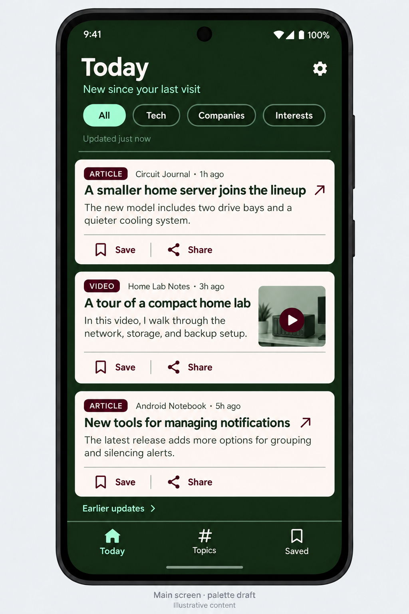
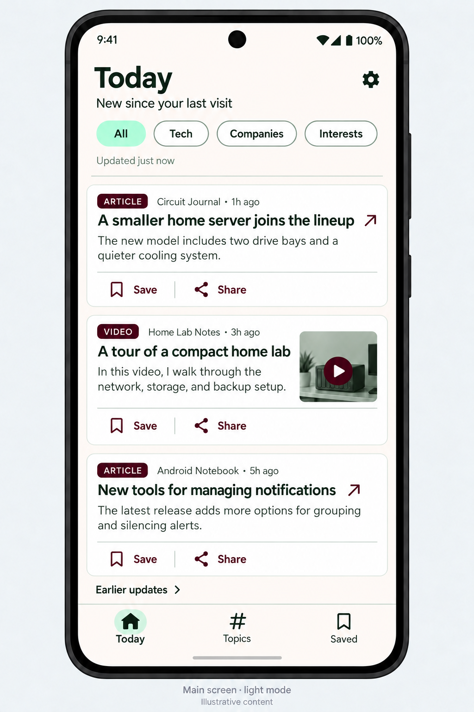

# Design Bible

Version 1.3 · October 10, 2026

Android personal news reader · Source-first · Lightweight

## 1. Purpose and authority

This document defines the shared visual and interaction rules for every screen and feature. The approved Today mockups establish the visual direction; the exact values below establish the implementation contract. The mockups are generated visual references, not pixel measurements. Font sizes, spacing, and state specifications below are proposed standards that turn the approved direction into repeatable rules.

When adding a page, reuse these tokens and components. Introduce a new rule only when an existing rule cannot meet the need, and record the decision here before reusing it elsewhere.

Implementation direction: native Android with Kotlin and Jetpack Compose, with all app data kept locally. The [v1 scope](v1-scope.md) records the architecture and 14-day unsaved-item retention. The earlier web-unit notes are optional equivalents; Android uses dp/sp directly.

## 2. Product principles

- Make catching up quick: headline, source, time, and a short source preview.
- Let chosen sources lead; topics organize and filter their updates.
- Show original source previews. Do not generate AI summaries or commentary. When no preview exists, omit it.
- Keep Save and Share easy to find; tapping a headline opens the original.
- Use compact text-first content, optional small thumbnails, and generous touch targets.
- Preserve the same hierarchy, layout, and behavior between themes.
- Avoid unread-count pressure, autoplay, large decorative images, and endless recommendation feeds.

## 3. Approved visual references

See the [Mockups Tracker](mockups-tracker.md) for the complete screen register, approval status, and gallery.

### Dark mode

Forest canvas, warm near-white cards, mint selected controls, burgundy actions.

### Light mode

Warm near-white canvas, white cards, forest text, mint selected controls, burgundy actions.

The phone frame, outer backdrop, sample news, and captions are presentation elements, not app UI. Build layouts for real device sizes; do not stretch the image or attempt to fit exactly three cards on every phone.

## 4. Color foundation

| Token | Value | Role |
|---|---|---|
| Forest | `#172815` | Main dark surface; primary text on light surfaces |
| Warm white | `#FFF8F3` | Almost white, with a very subtle peach undertone |
| White | `#FFFFFF` | Light-mode cards |
| Sage | `#708B75` | Borders and decorative accents |
| Burgundy | `#4C061D` | Save/Share, external-link arrows, content badges |
| Mint | `#A9FFCB` | Selected controls and dark-mode navigation highlights |
| Muted forest | `#526650` | Secondary text on light surfaces |
| Pale sage | `#DCE5DA` | Light dividers and card outlines |

The original saturated peach `#F7C59F` is retired. Do not use it on new screens. Warm white must read as near-white, not cream, orange, or pink.

### Semantic theme tokens

Use role names when building components so a theme switch changes the palette without changing the component.

| Role | Dark mode | Light mode |
|---|---|---|
| Page/header/navigation background | Forest | Warm white |
| Card/form/dialog surface | Warm white | White |
| Text on page background | Warm white | Forest |
| Secondary text on page background | Mint | Muted forest |
| Text on card/form/dialog | Forest | Forest |
| Secondary text on card/form/dialog | Muted forest | Muted forest |
| Actions on card/form/dialog | Burgundy | Burgundy |
| Links on page background | Mint | Forest |
| Selected filter background | Mint | Mint |
| Selected filter text | Forest | Forest |
| Inactive filter background | Forest | White |
| Inactive filter text | Warm white | Forest |
| Inactive filter border | Sage | Sage |
| Card outline | None | Pale sage |
| Divider on page background | Sage | Pale sage |
| Divider on cards | Pale sage | Pale sage |
| Badge background/text | Burgundy / Warm white | Burgundy / Warm white |
| Active bottom navigation | Mint icon and label | Forest icon and label, mint icon backdrop |
| Inactive bottom navigation | Warm white | Forest |

Never use mint text on a white surface or burgundy text on the forest background. Sage is primarily decorative; small text must use a stronger text token. This intentionally improves the low-emphasis “Updated just now” text from the dark mockup by using mint rather than sage.

## 5. Typography

Use the Android system sans-serif family, with a system sans-serif fallback. No custom font download is required. Use sentence case and left alignment for reading content.

| Element | Default size | Weight | Line height |
|---|---|---|---|
| Page title | 32 sp | Bold, 700 | 40 sp |
| Section title | 20 sp | Semibold, 600 | 28 sp |
| Item headline | 18 sp | Semibold, 600 | 24 sp |
| Preview/body | 16 sp | Regular, 400 | 24 sp |
| Source/time metadata | 13 sp | Regular, 400 | 20 sp |
| Control label | 14 sp | Medium, 500 | 20 sp |
| Bottom navigation label | 12 sp | Medium, 500 | 16 sp |
| ARTICLE/VIDEO badge | 11 sp | Medium, 500 | 16 sp |

For a web implementation, use rem units and scalable text equivalents. These are baseline sizes, not fixed constraints: respect user font settings and allow layouts to grow. Do not shrink text to fit a card.

## 6. Layout and spacing

- Use a 4-unit spacing grid: 4, 8, 12, 16, 20, 24, 32.
- Default page horizontal padding: 16 dp; header top padding: 16 dp below the safe area.
- Card padding: 16 dp. Space between cards: 12 dp.
- Source metadata to headline: 8 dp. Headline to preview: 8 dp. Preview to actions: 12 dp.
- Card corner radius: 16 dp. Input radius: 12 dp. Filters and badges: pill radius.
- Border and divider width: 1 dp. Default surfaces are flat, with no gradients or heavy shadows.
- Icons: 24 dp for actions and navigation; 16–20 dp for metadata and external-link indicators.
- Every interactive target is at least 48 × 48 dp even if the visible icon is smaller.
- Bottom navigation baseline height: 72 dp plus the device bottom safe area. Content scrolls above it and never hides behind it.
- Keep header compact, topic filters horizontally scrollable, and the feed vertically scrollable.
- Cards expand for larger text. A small phone may show fewer items than the mockup.

For web layouts, treat dp dimensions as baseline CSS-pixel equivalents, use flexible sizing, and account for safe-area insets. Do not reproduce a phone bezel inside the app.

## 7. Reusable components

### Page header

Large page title, optional one-line context, and an optional trailing utility action. Today uses “New since your last visit” and a settings gear. Settings must have an accessible name. Do not add branding banners or repeated explanatory paragraphs.

### Topic filters

Start with All, followed by the user's topic names. The sketch's Tech, Companies, and Interests labels are examples, not required categories. Selected filters use mint with forest text; other filters use the semantic inactive tokens. Allow horizontal scrolling and longer names without reducing font size.

### News card

Order: content-type badge + source + time; headline; source preview; optional thumbnail; action row.

- Original headline remains intact. Allow wrapping rather than cutting off essential words.
- Show at most three preview lines in the compact view; a visibly truncated preview is an excerpt, not a generated summary.
- If missing, omit the preview. For videos, use a description excerpt when provided.
- Keep source and time readable; allow metadata to wrap.
- Headline and external-link icon form the open action. Do not make the entire card an overlapping click target around Save/Share.
- Keep Save and Share labeled and in that order. Do not reintroduce repeated Open buttons.
- Save toggles to Saved with a filled bookmark and updated accessible state; it must remain reversible.
- Share sends the original URL through Android's share menu. Provide Copy link if native sharing is unavailable.
- Videos open in YouTube when available, otherwise the browser. Do not autoplay or embed a large player in the feed.

### Thumbnail

Optional and secondary, especially useful for video identification. Baseline 88 × 80 dp, radius 8 dp, cropped to fill. A burgundy play badge with warm-white triangle identifies videos. Hide the thumbnail when space is insufficient for readable text, including enlarged font settings.

### Bottom navigation

Exactly three primary destinations: Today, Topics, Saved. Preserve order and visible labels on every primary screen. Mark the active destination visually and programmatically. Settings and secondary features belong within those destinations or the header, rather than adding tabs automatically.

### Topics list — approved Light/Dark layout

Use the shared page header with “Your interests, your sources”, followed by a mint Add topic button and a Your topics section. Topic cards reuse the shared card surface, radius, outline, and spacing. Show the topic name, connected-source count, short source-name preview, and a trailing chevron. Tapping a card opens that topic's filtered updates.

Place Manage sources below the topic list, with an RSS outline icon, the description “Add websites, feeds, and YouTube channels”, and a trailing chevron. Keep Topics selected in the shared bottom navigation. Source counts describe connected sources, not unread items. Example topics are not fixed categories.

Both Light and Dark mockups are approved and linked in the Mockups Tracker. Apply the shared theme tokens and retain the same structure.

### Saved list — approved Light/Dark layout

Use the shared page header with “Articles and videos for later”, a Search saved items field, and All/Articles/Videos filter pills. All is selected initially. Display “Newest saved first” above the list, ordered by when items were saved.

Reuse news cards with original headlines, source names, source-provided previews, and optional video thumbnails. The compact approved layout omits publication time from the top row. Headline taps open the original. Show a filled burgundy bookmark with the label Saved, followed by Share. The Saved action removes the bookmark reversibly and offers Undo. Keep Saved selected in bottom navigation. Use identical controls and structure in both themes.

Do not add collections, folders, bulk actions, or additional navigation without a deliberate design update. A search field must have an accessible label even when its visible cue is placeholder text.

### Manage sources — approved Light/Dark layout

Manage sources is a secondary screen under Topics. Use a Back to Topics control, the page title, and “Choose where your updates come from”. Keep Topics selected in the shared bottom navigation.

Place a mint Add source action above Search sources and the Your sources list. Source cards reuse the shared surface, radius, spacing, and theme tokens. Show a source-type icon, source name, readable type label, assigned topics, and a trailing chevron. A card opens source settings for editing details, topic assignments, and removal; source settings are not yet visually specified.

Use Website feed, RSS feed, and YouTube channel as source-type labels. Website feed refers to a feed discovered from a website. Source examples are illustrative. Keep the list free of unread counts, per-row delete buttons, and unnecessary status metrics. Search must have an accessible label; long names and topic lists must wrap without shrinking text.

### Forms and secondary screens

Reuse the same header, spacing, surfaces, and text tokens. Inputs have visible labels, 48 dp minimum height, and borders that become forest on light surfaces when focused. Primary buttons use mint with forest text; secondary buttons use clear outlines and the local text token. Destructive actions use burgundy on a light surface, an explicit label, and confirmation where the action is difficult to undo.

### Dialogs and sheets

Use the card surface and card text colors in both modes. Keep one clear title, concise content, and a small number of labeled actions. Account for the keyboard and safe areas. Avoid putting burgundy text directly on the dark page background.

## 8. States and accessibility

- Theme options: System, Light, Dark. Default to System, and remember an explicit override.
- Use at least 4.5:1 contrast for normal text, 3:1 for large text and essential icons/control boundaries. Pale decorative separators do not replace required control boundaries.
- Selected state includes a changed shape/fill or icon state as well as color. Expose selected/saved states to assistive technology.
- Use a visible 2 dp forest focus ring on light surfaces and mint ring on dark surfaces, with enough offset to separate it from the control.
- Pressed state is a subtle temporary surface change; disabled state must also be exposed semantically. Never rely on color alone for unavailable controls.
- Loading: quiet skeletons or one loading indicator. Avoid flashing, long animations, and invented previews.
- Empty: a short explanation and one useful action, such as Add source or Browse updates.
- Errors: clear text with an icon and a recovery action. Keep existing content available; identify which source failed if others succeeded.
- Offline: show cached cards with a visible offline/last-updated label. Queue reversible saves if supported, and show pending state until confirmed.
- After the new batch ends, show “You're caught up” and an Earlier updates link; no growing unread counter.
- Use brief feedback for Save and link-copy actions. Respect reduced motion and avoid animation required to understand a state.

## 9. Language and content

Use Today, Topics, Saved, Save, Saved, Share, Earlier updates, Add source, and Updated just now consistently. Use ARTICLE and VIDEO only in compact content badges. RSS describes the source format, not a separate reading category.

Use relative times for recent content and clear dates for older items. Use plain language, short prompts, and honest empty/error states. Example articles in mockups are illustrative, not actual news.

Sharing an individual link into Saved must not automatically subscribe to its publisher. Discovery beyond chosen sources is optional and separate from the main source-first feed.

## 10. New-page review checklist

- Uses named semantic tokens rather than ad hoc colors.
- Works in both Light and Dark with the same layout and behavior.
- Uses the defined type scale, spacing grid, radii, icons, and touch targets.
- Reuses headers, filters, cards, actions, inputs, and navigation wherever applicable.
- Keeps original headlines and source previews; introduces no generated summaries.
- Handles loading, empty, error, offline, and saved states where relevant.
- Remains usable on a narrow Android screen and with enlarged text.
- Has readable contrast, accessible labels, visible focus, and understandable state changes.
- Preserves simple reading, saving, and sharing without adding unnecessary navigation.
- Records deliberate new patterns or token changes in this document.

## 11. Change control

The approved appearance is the baseline. Improvements to accessibility and responsive behavior take precedence over matching incidental details in a generated mockup. Preserve the approved visual direction while making those improvements.

For each intentional design-system change, record the date, reason, affected token/component, and updated references. A new feature should use an existing pattern before inventing another. Update both theme references when a shared visual pattern changes.

| Version | Date | Change |
|---|---|---|
| 1.0 | October 10, 2026 | Approved Light/Dark direction documented; exact semantic tokens and reusable layout/component rules established. |
| 1.1 | October 10, 2026 | Topics Light layout approved; reusable topic-list pattern added and Mockups Tracker linked. |
| 1.2 | October 10, 2026 | Topics Dark and Saved Light/Dark approved; shared Saved list pattern documented. All three primary screens now have approved theme counterparts. |
| 1.3 | October 10, 2026 | Manage sources Light/Dark approved; shared source-list and secondary navigation patterns documented. |

## App identity

October 10, 2026: Card-stack icon (option 1) approved. Forest background, warm-white front card, mint rear card and corner tab, forest headline bars. Implement as a vector adaptive icon with a monochrome themed variant. Repository/project title: BARF - Boogies Aggregated RSS Feed. App display label remains Local Brief until separately renamed.

