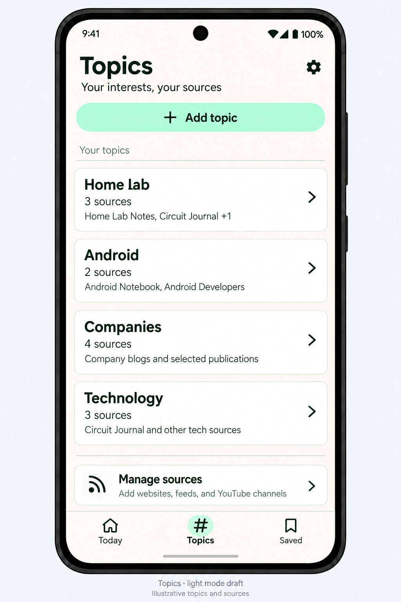
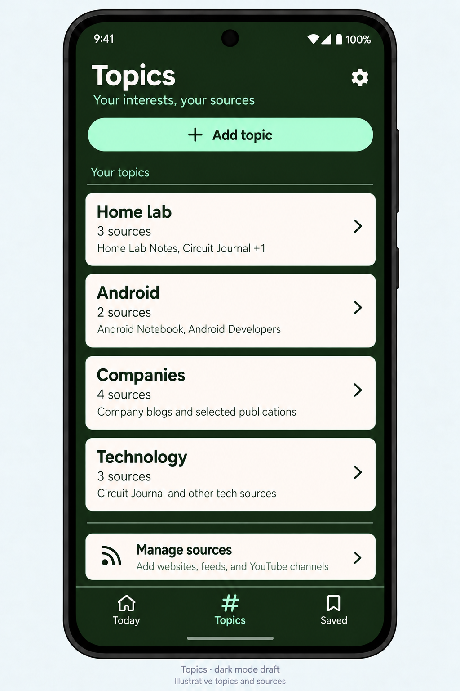
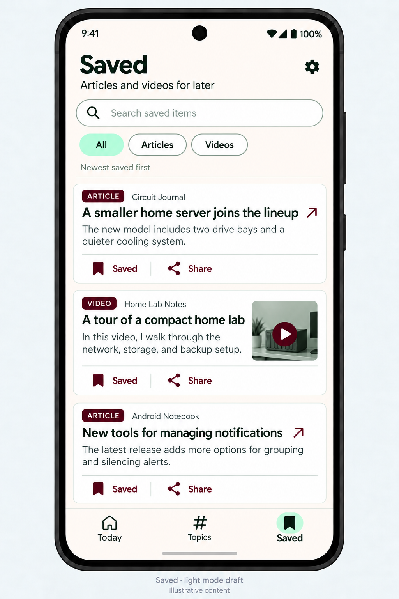
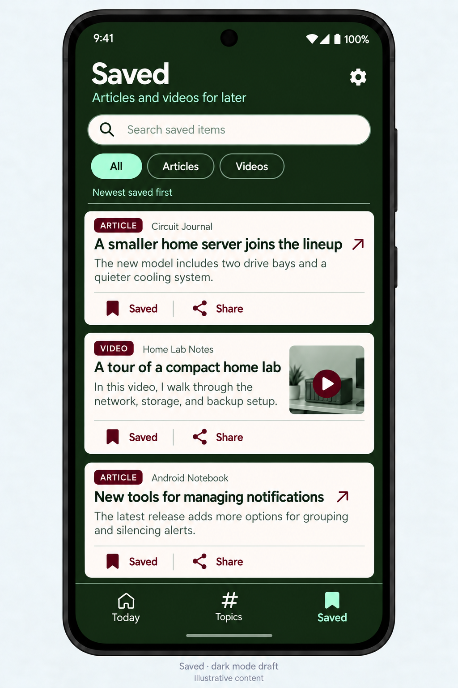
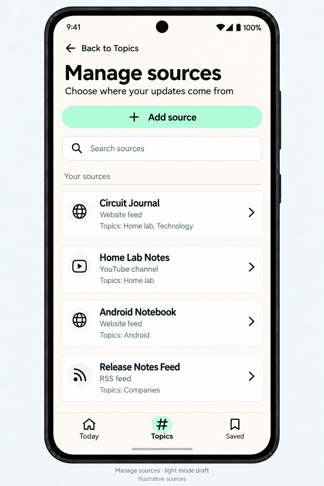
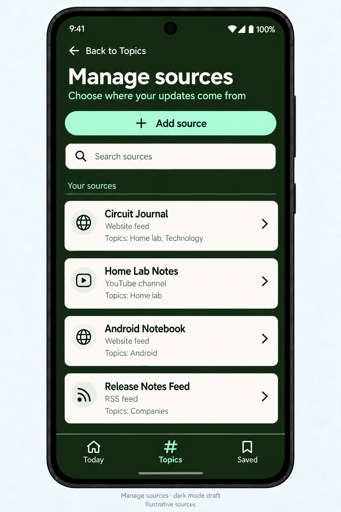

# Mockups Tracker

Updated October 10, 2026

This is the central index of screen mockups and approvals for the Android personal news reader. Use the [Design Bible](design-bible.md) for shared colors, typography, spacing, components, and interaction rules.

## Screen register

| ID | Screen | Theme | Status | Reference | Approved |
|---|---|---|---|---|---|
| M-001 | Today | Dark | Approved · v1 | [View mockup](design-reference/today-dark.png) | October 10, 2026 |
| M-002 | Today | Light | Approved · v1 | [View mockup](design-reference/today-light.png) | October 10, 2026 |
| M-003 | Topics | Light | Approved · v1 | [View mockup](design-reference/topics-light.png) | October 10, 2026 |
| M-004 | Topics | Dark | Approved · v1 | [View mockup](design-reference/topics-dark.png) | October 10, 2026 |
| M-005 | Saved | Light | Approved · v1 | [View mockup](design-reference/saved-light.png) | October 10, 2026 |
| M-006 | Saved | Dark | Approved · v1 | [View mockup](design-reference/saved-dark.png) | October 10, 2026 |
| M-007 | Manage sources | Light | Approved · v1 | [View mockup](design-reference/manage-sources-light.png) | October 10, 2026 |
| M-008 | Manage sources | Dark | Approved · v1 | [View mockup](design-reference/manage-sources-dark.png) | October 10, 2026 |

“Approved” records the user's visual approval. It does not mean a screen is implemented or device-tested. An approved theme does not automatically approve an uncreated counterpart.

## Approved screen behavior

### Today — M-001 / M-002

- Shows new arrivals since the last visit, with topic filters and Earlier updates.
- Each card contains an original headline, source, time, and source-provided preview when available.
- Headlines open the original article or video. Save and Share remain visible.
- Light and Dark share the same hierarchy and controls.

### Topics — M-003 / M-004

- Header: Topics, “Your interests, your sources”, and settings.
- Mint Add topic action above the Your topics list.
- White rounded topic cards show a name, connected-source count, source preview, and a chevron.
- Tapping a topic opens its filtered updates.
- Manage sources provides access to websites, RSS feeds, and YouTube channels.
- Bottom navigation remains Today · Topics · Saved, with Topics selected.
- Home lab, Android, Companies, Technology, and all example sources are illustrative, not fixed user data or required categories.

### Saved — M-005 / M-006

- Header: Saved, “Articles and videos for later”, and settings.
- Search saved items and filter All, Articles, or Videos.
- Show newest saved items first.
- Reuse news cards with original headlines, source previews, and optional video thumbnails.
- Filled Saved bookmark toggle and Share remain visible. Tapping a headline opens the original.
- Removing a bookmark should offer Undo.
- Bottom navigation retains Today · Topics · Saved, with Saved selected.
- Light and Dark share the same layout and controls.

### Manage sources — M-007 / M-008

- Back to Topics returns to the parent screen; Topics remains selected in navigation.
- Add source begins adding a website feed, RSS feed, or YouTube channel.
- Search sources filters the existing list.
- Each card shows a source name, type, assigned topics, and a chevron leading to source settings.
- Source settings handle editing details, topic assignments, and removal; that detail screen is not yet mocked up.
- Keep unread counts and inline destructive controls out of this list.
- Both themes share the same structure and illustrative source data. Website feed means a feed discovered from a website, rather than monitoring arbitrary pages without feeds.

## Visual gallery

### Today · Dark · Approved

### Today · Light · Approved

### Topics · Light · Approved

### Topics · Dark · Approved

### Saved · Light · Approved

### Saved · Dark · Approved

### Manage sources · Light · Approved

### Manage sources · Dark · Approved

All eight registered mockups are approved. The approval record above is authoritative; image captions may retain the word “draft” from generation. Earlier draft filenames are retained so previous chat links continue to work.

## Tracking rules

1. Add new screen/theme entries with a stable ID and a Draft status when a mockup exists.
2. Keep screen images together in design-reference and link them from this register.
3. Mark a mockup Approved only after user approval, recording the date and version.
4. Preserve approved images when proposing revisions; use a new versioned filename and record the replacement after approval.
5. Record new reusable patterns in the Design Bible when approved. Keep illustrative screen content separate from product requirements.
6. Keep the gallery limited to current approved versions. Record superseded references in the change log when applicable.

## Change log

| Date | Change |
|---|---|
| October 10, 2026 | Tracker created; approved Today Light/Dark registered and Topics Light locked as v1. |
| October 10, 2026 | Topics Dark and Saved Light/Dark created and registered as v1 drafts for review. |
| October 10, 2026 | User approved all three drafts; Topics Dark and Saved Light/Dark locked as v1 and added to the approved gallery. |
| October 10, 2026 | Manage sources Light/Dark created and registered as v1 drafts for review. |
| October 10, 2026 | User approved Manage sources Light/Dark; both locked as v1 and moved into the approved gallery. |

## App icon

Option 1 (card stack) approved October 10, 2026. Reference: [approved icon concept](app-icon/approved-card-stack.png). Native vector recreation included in build 0.1.1.

